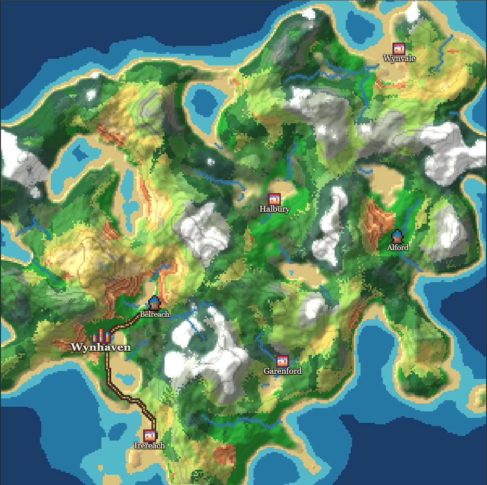

# Sekai

A procedural world generator that transforms seeded noise into explorable maps with varied terrain, biomes, rivers, settlements, and roads.

**[Try Sekai →](https://sekai-sepia.vercel.app)**



## Features

- **Seeded generation:** Generate random worlds using a seed, so you can recreate maps you like.
- **Three terrain types:** Generate landmasses, islands, and mountain ranges.
- **Procedural geography:** Generate terrain with different elevations, climates, and Minecraft-inspired biomes.
- **Rivers and roads:** Add procedurally generated rivers, settlements, and roads to make the maps feel more like actual worlds.
- **Settlements:** Populate maps with named settlements and sprites.
- **PNG export** 

## Run locally

You'll need Node.js and npm installed.

```bash
git clone https://github.com/4nav/sekai
cd sekai
npm install
npm run dev
```

## How it works

Sekai generates a heightmap from a seed, then shapes it according to the selected terrain type. Elevation and seeded climate data determine the terrain's appearance, while hydrology, settlement placement, and road generation add features that interact with the geography.

The project is built with React, TypeScript, Vite, and the HTML Canvas API, with the generation pipeline split into separate modules for terrain, climate, rivers, settlements, roads, and rendering.

## Acknowledgements

AI tools were used to help generate settlement names and sprites. 